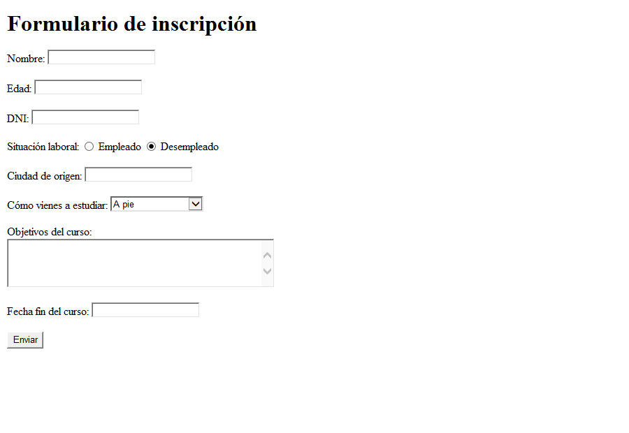

# Mi presentación 

Crea un formulario para enviar tu presentación en el curso al que estás asistiendo.
Busca en este [enlace](https://www.w3schools.com/html/html_form_elements.asp) los diferentes tipos de controles de formulario que existen para crear todo lo que se te pide en la parte 1

## Parte 1 - Campos que debe tener el formulario

- Nombre. Como mucho tiene 50 carácteres de largo. Campo requerido.
- Edad. Debe ser un número entre 18 y 99. Piensa que existe un control que nos obliga a poner solo números. Campo requerido.
- DNI: Excactamente debe tener 9 carácteres.
- Situación laboral: Empleado o desempleado. Por defecto, debe estar seleccionado desempleado.
- Ciudad de origen. Texto libre de hasta 100 carácteres. Campo requerido.
- Como vienes a estudiar. Es un selector con 3 opciones: A pie, transporte público, trasporte privado. Por defecto, debe estar seleccionado "a pie". Campo requerido. 
- Objetivos del curso. Es un texto libre de hasta 1024 carácteres. No es obligatorio.
- Fecha fin del curso. Debe poderse seleccionar una fecha. Es obligatorio rellenarlo.

Si el formulario no cumple alguna de las validaciones NO debe poderse enviar.

## Parte 2 - Configuración del formulario 

1. El **atributo** action debe tener por valor el **endpoint** donde vamos a enviar la información. En este caso es: https://request-data.onrender.com/register. Tienes algo de ayuda en [este enlace](https://lenguajehtml.com/html/formularios/etiqueta-html-form/#ejemplo-b%C3%A1sico-1)
2. El método de envío HTTP debe ser  **POST**.
3. Recuerda que es **imprescindible** que cada campo del formulario tenga el atributo **name**; o no se va a enviar ningún tipo de información.
4. Tras darle a enviar, sabrás que tus datos han llegado correctamente porque verás esta información en el navegador:
 

Puedes comprobar además si tu petición ha llegado a buen puerto en la URL: https://request-data.onrender.com

### Parte 3 - BONUS: Validar el DNI Español

Investiga cómo se hace para hacer que el texto del campo DNI sea validado.  
Puedes buscar por Internet cómo se puede usar el atributo _pattern_ del tag _input_ para lograrlo.  
Te adjunto una [solución](https://oscarm.tinytake.com/media/171dbb1?filename=1738236609479_TinyTake30-01-2025-12-30-03_638738334086463695.png&sub_type=thumbnail_preview&type=attachment&width=748&height=509) con su explicación.

## Ayuda para construir el formulario

| Campo | Control y atributos que puedes consultar |
| --- | --- |
| Nombre | `input type="text"`, `maxlength="50"` y `required`. |
| Edad | `input type="number"`, `min="18"`, `max="99"` y `required`. El paso predeterminado es 1 para edades enteras. |
| DNI | `input type="text"`, `minlength="9"` y `maxlength="9"`. |
| Situación laboral | Dos `input type="radio"` con el mismo `name`, distintos `value` y `checked` en desempleado. |
| Ciudad | `input type="text"`, `maxlength="100"` y `required`. |
| Transporte | `select` con `required` y tres `option` con su `value`. Usa `selected` en «A pie». |
| Objetivos | `textarea` con `maxlength="1024"`, sin `required`. |
| Fecha fin | `input type="date"` con `required`. |

- Relaciona cada `label` con su control mediante `for` e `id`. También puedes colocar el control dentro de su `label`, como en las opciones de situación laboral.
- Cada control que envía datos necesita `name`. Compartir el mismo `name` en los botones de opción permite elegir solo una situación.
- Configura `action` y `method="post"` en `form`. Un botón `type="submit"` comprueba las validaciones antes del envío.
- Puedes usar ` ` para separar líneas. No necesitas CSS ni JavaScript.
- Abre el ejercicio con Live Server. Prueba los campos vacíos y sus límites; utiliza datos ficticios si pruebas el envío al servicio de demostración.

**Aclaración sobre el DNI:** el enunciado no lo marca como obligatorio, así que puede dejarse vacío. Si se rellena, debe tener nueve caracteres. Estos atributos comprueban la longitud, pero no el formato español ni la letra de control. La solución básica de la rama `solution` no usa `pattern` ni resuelve el BONUS. Validar un formato tampoco garantiza que la letra del DNI sea correcta.

## Diseño esperado

La captura muestra el formulario vacío y las opciones iniciales. El aspecto de los controles puede variar según el navegador.

